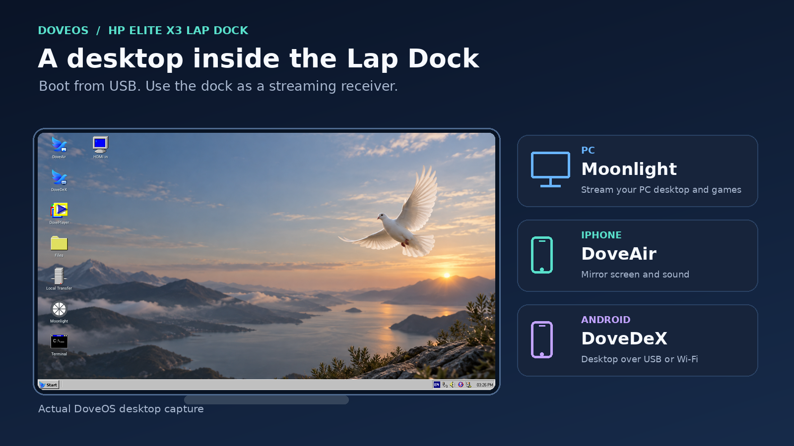
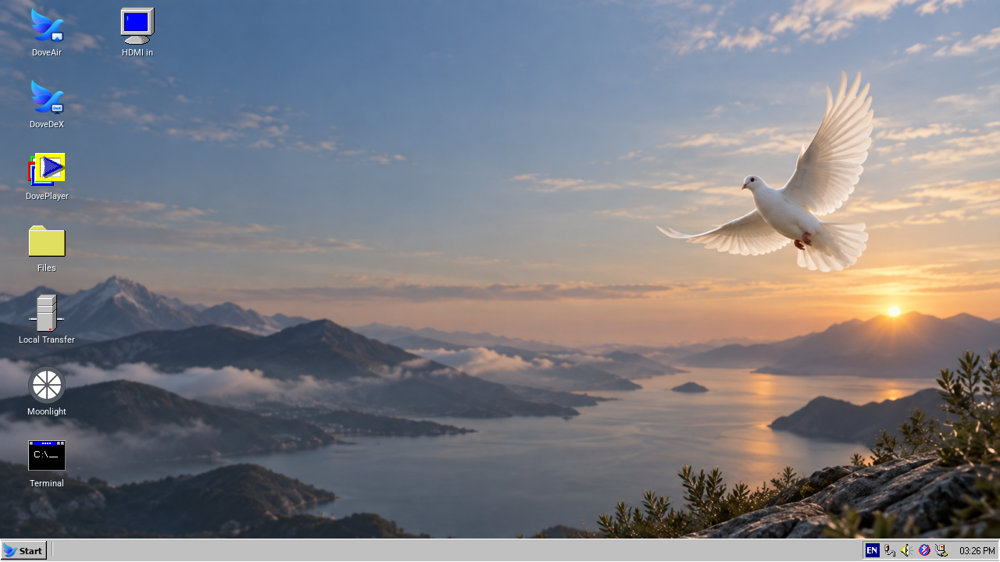
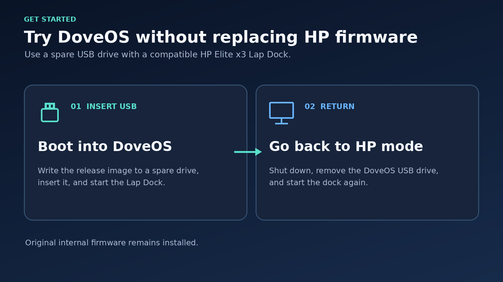
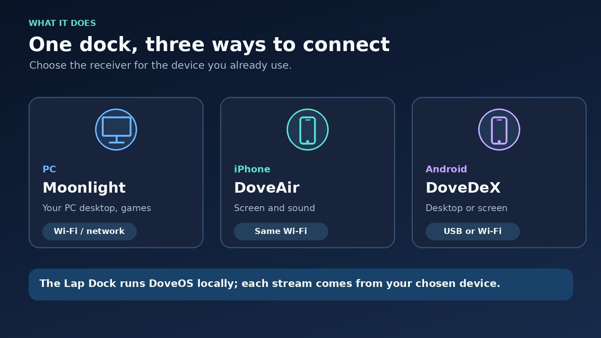

# DoveOS

A USB desktop and streaming environment for the **HP Elite x3 Lap Dock**.
DoveOS uses the dock's built-in processor, display, keyboard, touchpad and
existing Linux kernel to provide a 720p desktop and streaming applications.

**Public release candidate:** manual image download, USB writing and boot have
been completed successfully on the tested dock. Other board and firmware
revisions remain unverified. See compatibility before preparing a drive.

[Download the USB image](https://github.com/hakami55/DoveOS/releases/tag/v2.0.0-rc.1) | [Install and boot](docs/INSTALL.md) | [Hardware compatibility](docs/COMPATIBILITY.md) | [Applications](docs/APPS.md) | [Source and build](docs/BUILD.md)

## Desktop preview

Actual 720p DoveOS desktop on the Lap Dock:

## Get started

1. Download the image ZIP, `SHA256SUMS` and installation guide from Releases.
2. Extract the ZIP and write its IMG to a spare USB of **32 GB or larger** with Rufus or balenaEtcher. Only one image writer is needed. Writing erases the selected USB.
3. Leave the left USB-C port empty, insert the prepared USB into a right port and start the dock.
4. Configure your own network and pairings in Settings and the relevant apps.

Keep the working USB until the new copy boots and your required apps are checked.
Compatible existing HP firmware and boot setup are required. The optional startup
logo needs its matching internal splash hook. See the installation guide.

## Connection options

For pairing and connection steps, see [Applications](docs/APPS.md).

## Included

- 720p GPU desktop, Files, Settings, Terminal and lightweight desktop tools.
- Moonlight: PC streaming with controls and sound; H.264 and supported HEVC paths.
- DoveDeX: supported Android desktop or screen streaming over USB or Wi-Fi.
- DoveAir: iPhone mirroring with sound and orientation changes.
- DoveCast: YouTube receiver with TV-code pairing; YouTube only.
- DovePlayer: local video and audio through supported playback paths.
- Local Transfer: share a folder with a browser on your local network.
- HDMI In: viewer for a supported external USB capture card.
- Controller Tester and the DoveOS SDK.

Settings puts System last, with live CPU, RAM, swap, renderer, resolution,
storage, network and uptime details. Power Options uses a clear power symbol.

## Current limits

- The internal right-side USB data path currently operates at USB 2.0 speed; USB 3.0 remains unresolved.
- Ordinary flash-drive use through the left USB-C port in DoveOS is unsupported.
- Wi-Fi channel/security/recovery and Bluetooth profile support have limits.
- Full power-off and wake remain unresolved; screen-off/wake is a separate function.
- Some mirrored source videos still need quality improvements.
- A 1080p desktop is outside the chosen release scope. Supported video streaming paths have separate limits.

## Source

This repository contains DoveOS source and relevant upstream components.
Images are separate release assets. Personal files, network profiles, pairings,
keys, raw firmware/RAM dumps and unrelated projects are excluded.
Build scripts document the original environment and may require path changes;
a fully independent end-to-end image build is not established yet.

Third-party components retain their original licenses. See [Notices](NOTICE.md).
Report problems with the dock's board/firmware revision if known, the affected
app, connection type and steps to reproduce. Do not include credentials.
